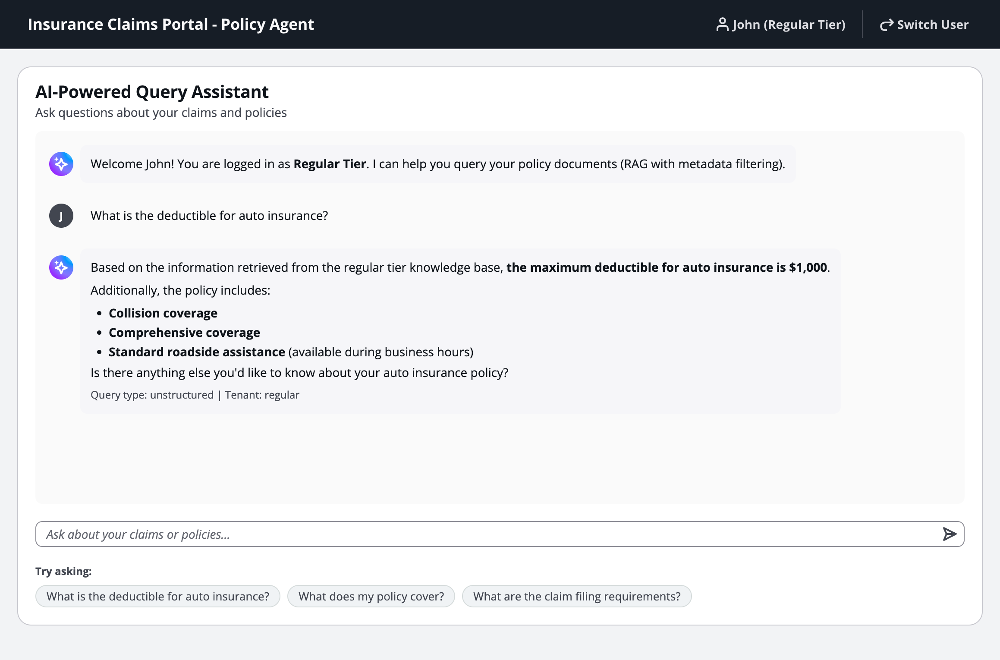
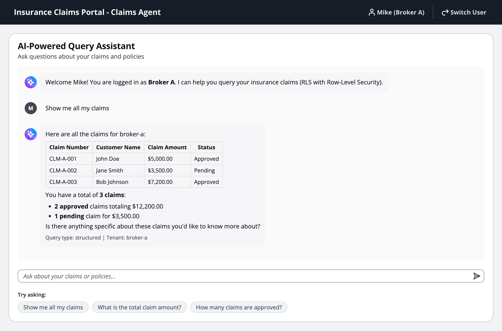
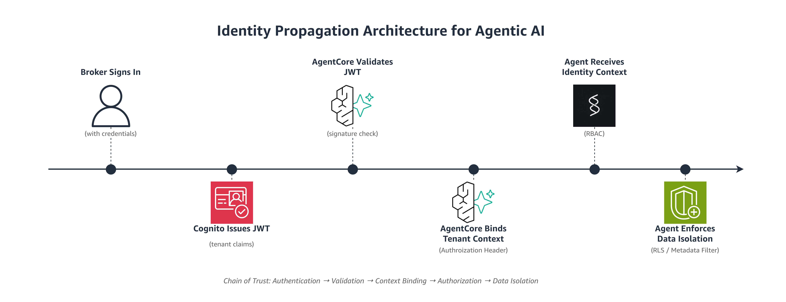
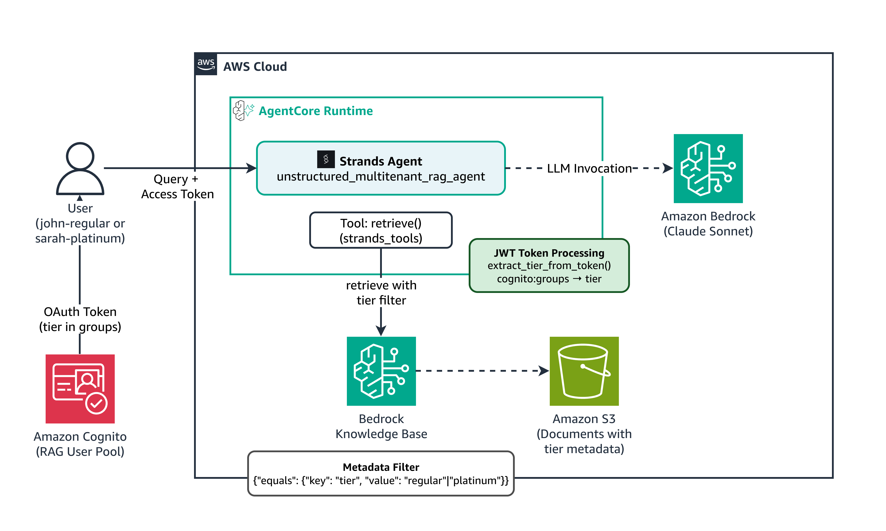
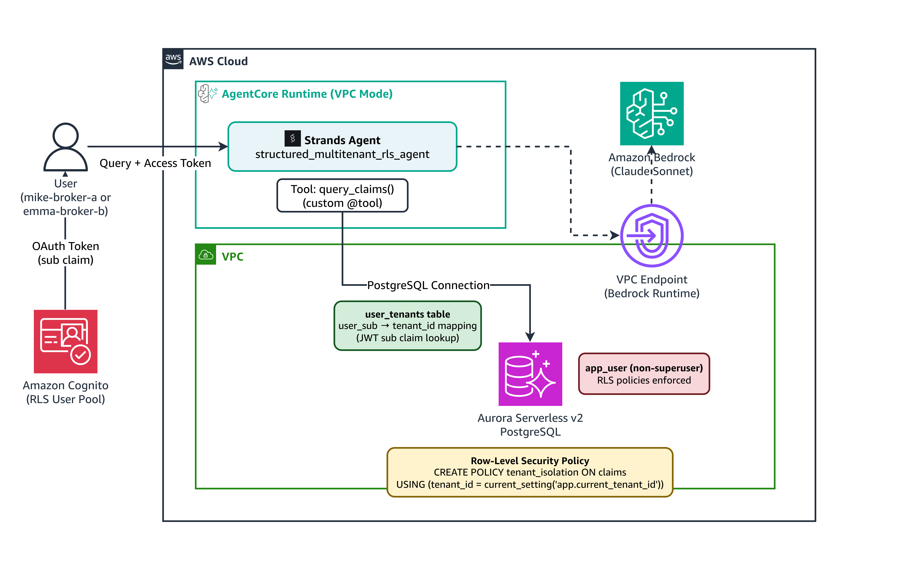
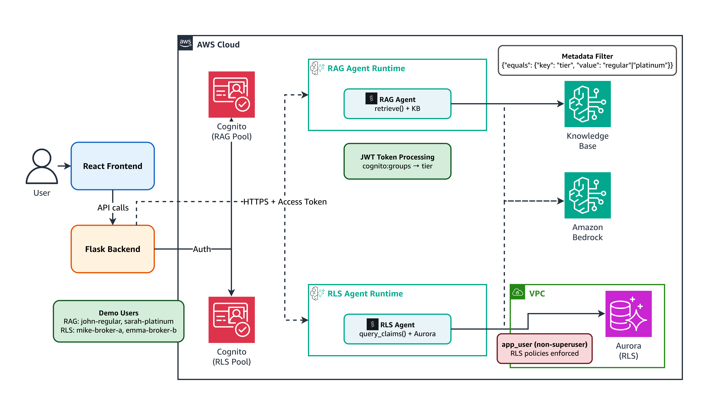

# Securing Multi-Tenant Architectures for Agentic AI on AWS

Organizations are integrating agentic AI capabilities into their applications to improve business processes and perform sophisticated workflows with accuracy. As these applications serve multiple tenants, it is critical to ensure that the capabilities of the agent and its ability to acquire knowledge are limited to the scope of a given customer's environment.

For example, an insurance claims platform might allow multiple brokers to ask questions like "How many claims were filed last week?" or "What is the maximum deductible for auto insurance?". The system needs to understand these queries, execute agents to generate responses, and ensure that each tenant (in this case, an insurance broker) sees only their own customer's data.

In this post, we demonstrate how to implement robust tenant isolation in agentic AI applications that query different types of data sources (structured and unstructured). You'll learn a defense-in-depth approach combining:
- **Row-Level Security (RLS)** at the database layer for structured data
- **Metadata filtering** for unstructured data sources with Amazon Bedrock Knowledge Bases
- **Secure tenant context management** throughout the application stack using Amazon Bedrock AgentCore Runtime

## The Challenge: One Platform, Many Tenants

Consider an insurance claims platform that serves multiple insurance brokers. Each broker needs to ask questions about their customers' claims and policy documents—but they should never see another broker's data. When Broker A asks "How many claims were filed last week?", they should only see their own customers' claims, not Broker B's.

<p align="center">
  
  
  <br/>
  <em>Same question, different answers: Each broker sees only their own data</em>
</p>

This scenario requires two types of data isolation:
- **Unstructured data** (policy documents): "What is the maximum deductible for auto insurance?" → Answer varies by customer tier
- **Structured data** (claims database): "Show me all pending claims" → Results filtered by broker's tenant

The solution combines Amazon Cognito for authentication, Amazon Bedrock AgentCore for secure agent execution, and tenant-aware data access patterns at both the document and database layers.

## How Identity Propagates Through the Stack

In a multi-tenant environment such as the insurance claims platform, maintaining a consistent identity across every component of the system is essential for both security and data isolation. This model applies to all types of workloads—whether an agent is querying structured data or retrieving unstructured documents.

<p align="center">
  
  <br/>
  <em>Identity propagation from Cognito through AgentCore to data layer</em>
</p>

The flow starts when a broker signs in through Amazon Cognito User Pools, which can federate with enterprise identity providers like Microsoft Entra ID (Azure AD) or Google. After authentication, Cognito issues a tenant-aware JSON Web Token (JWT) that contains standard identity attributes along with custom claims such as `tenant_id` and `cognito:groups`. For M2M authorization scenarios, you can also leverage [custom OAuth 2.0 scopes](https://docs.aws.amazon.com/cognito/latest/developerguide/scope-based-multi-tenancy.html) to define tenant-specific access controls.

When the broker initiates a request, it is processed by the Amazon Bedrock AgentCore Runtime. AgentCore validates the JWT to confirm that it was issued by the trusted Cognito User Pool and extracts the relevant identity claims. It then binds the tenant context to the agent's runtime session, establishing a trusted AgentCore identity. This identity context is automatically included in every subsequent interaction between agents, tools, and services, ensuring that all actions within the session occur under the same verified tenant context.

The Strands Agent receives the request along with the propagated identity context. It interprets the JWT claims and applies role-based access controls (RBAC) to determine what operations the authenticated tenant is permitted to perform:
- **For unstructured data**: The tenant identity is applied through metadata-based filtering, which limits visibility to only those resources tagged for that tenant
- **For structured data**: Controls are enforced through Row-Level Security (RLS), ensuring that each query runs only against records associated with the authenticated tenant

This approach creates a continuous chain of trust from authentication to data access:
1. **Cognito** establishes the root of trust by verifying the user's identity
2. **Bedrock AgentCore Runtime** extends that trust through runtime validation and session-level propagation
3. **Strands Agents** complete the loop by enforcing authorization policies and tenant isolation during data retrieval and processing

Together, these layers ensure that every agentic interaction—whether generating a response, executing a query, or retrieving information—is securely bound to the user's verified identity and tenant context.

## Tenant and User Data Isolation at the Data Layer

### Unstructured Data Sources: Metadata Filtering

For unstructured data such as policy documents, compliance guides, and knowledge base articles, Amazon Bedrock Knowledge Bases provides a fully managed RAG solution with built-in metadata filtering capabilities. This enables tenant isolation at the document level without requiring separate knowledge bases per tenant.

The pool-based approach uses a single knowledge base with metadata tags to identify document ownership. Each document uploaded to Amazon S3 includes a corresponding `.metadata.json` file that specifies the tenant ID and other attributes:

```json
{
  "metadataAttributes": {
    "tier": "regular",
    "document_type": "policy"
  }
}
```

During ingestion, Amazon Bedrock Knowledge Bases automatically indexes these metadata fields alongside the document vectors, enabling efficient filtered retrieval at query time.

### Structured Data Sources: Row-Level Security

Tenant and user data isolation at the database layer starts with [data partitioning design](https://aws.amazon.com/blogs/database/multi-tenant-data-isolation-with-postgresql-row-level-security/) decisions in multi-tenant systems. There are three common approaches:

| Approach | Description | Pros | Cons |
|----------|-------------|------|------|
| **Silo** | Separate database instance per tenant | Complete isolation | High operational costs |
| **Bridge** | Shared instance, different schema per tenant | Better resource sharing | Complex management |
| **Pool** | Shared tables with tenant IDs | Cost-efficient | Requires robust security controls |

For more information about multi-tenant data partitioning, see the [AWS SaaS Factory whitepaper](https://d1.awsstatic.com/whitepapers/Multi_Tenant_SaaS_Storage_Strategies.pdf).

By centralizing the enforcement of RDBMS isolation policies at the data layer, you ease the burden on your software developers. This allows you to take advantage of the benefits of the pool model *and* reduce the risk of cross-tenant data access. Using Row-Level Security (RLS), you can have granular access control over your sensitive data—deciding which users or roles can access specific records based on security policies defined at the database objects level.

## Tutorial 1: Multi-Tenant RAG with Metadata Filtering

The first tutorial demonstrates tenant isolation for unstructured data using Amazon Bedrock Knowledge Bases with metadata filtering based on Cognito groups.

### Architecture

<p align="center">
  
</p>

### How It Works

1. **User Authentication**: User authenticates with Cognito and receives a JWT with group membership (`regular` or `platinum`)
2. **JWT Validation**: AgentCore Runtime validates the token signature and expiration
3. **Tier Extraction**: The Strands Agent extracts the user's tier from the `cognito:groups` claim
4. **Metadata Filtering**: The agent builds a filter and calls `strands_tools.retrieve` with tier-based filtering
5. **Isolated Results**: Only documents matching the user's tier are retrieved and used for response generation

### Query-Time Filtering

The Strands agent extracts the tier from the JWT token and applies it as a metadata filter:

```python
# Extract tier from cognito:groups claim
groups = token_claims.get('cognito:groups', [])
tier = groups[0] if groups else 'regular'

# Build metadata filter
retrieval_filter = {
    "equals": {
        "key": "tier",
        "value": tier
    }
}

# Call retrieve with filtering
response = retrieve(
    knowledge_base_id=knowledge_base_id,
    query=user_query,
    retrieval_filter=retrieval_filter
)
```

### Example: Same Query, Different Results

| User | Tier | Query | Result |
|------|------|-------|--------|
| john-regular | regular | "What is the deductible for auto insurance?" | $1,000 |
| sarah-platinum | platinum | "What is the deductible for auto insurance?" | $500 |

The metadata filter is enforced at the vector database layer, making it impossible for users to access documents from other tiers—even with prompt injection attempts.

**[View Tutorial 1 →](https://github.com/aws-samples/sample-bedrock-agentcore-multitenant/tree/main/notebooks/01-unstructured-multitenant-rag)**

## Tutorial 2: Multi-Tenant Database with Row-Level Security

The second tutorial demonstrates tenant isolation for structured data using Aurora Serverless v2 PostgreSQL with Row-Level Security.

### Architecture

<p align="center">
  
</p>

### How It Works

1. **User Authentication**: User authenticates with Cognito and receives a JWT with their `sub` claim
2. **JWT Validation**: AgentCore Runtime validates the token
3. **User-Tenant Lookup**: The agent extracts `sub` from the JWT and looks up the tenant_id from the `user_tenants` table
4. **Session Variable**: The agent sets `app.current_tenant_id` PostgreSQL session variable
5. **RLS Enforcement**: All subsequent queries are automatically filtered by the RLS policy

### Database Schema with RLS

```sql
-- User-tenant mapping table
CREATE TABLE user_tenants (
    user_sub VARCHAR(100) PRIMARY KEY,
    tenant_id VARCHAR(50) REFERENCES tenants(tenant_id)
);

-- Claims table with tenant isolation
CREATE TABLE claims (
    id SERIAL PRIMARY KEY,
    tenant_id VARCHAR(50) NOT NULL,
    claim_number VARCHAR(20) NOT NULL,
    customer_name VARCHAR(100) NOT NULL,
    claim_amount DECIMAL(10,2) NOT NULL,
    status VARCHAR(20) NOT NULL
);

-- Enable Row-Level Security
ALTER TABLE claims ENABLE ROW LEVEL SECURITY;

-- RLS Policy: Users can only see rows matching their tenant
CREATE POLICY tenant_isolation ON claims
    FOR ALL
    USING (tenant_id = current_setting('app.current_tenant_id', true));
```

### Important: Use Non-Superuser Database Accounts

A critical security consideration: PostgreSQL superusers (like `postgres`) bypass RLS policies entirely. The tutorial creates a dedicated `app_user` with limited permissions:

```sql
-- Create application user (non-superuser)
CREATE USER app_user WITH PASSWORD 'secure_password';

-- Grant limited permissions
GRANT USAGE ON SCHEMA public TO app_user;
GRANT SELECT ON claims, tenants, user_tenants TO app_user;
```

### Example: Tenant-Isolated Claims

| User | Tenant | Query | Visible Claims |
|------|--------|-------|----------------|
| mike-broker-a | broker-a | "Show me all claims" | CLM-A-001, CLM-A-002, CLM-A-003 |
| emma-broker-b | broker-b | "Show me all claims" | CLM-B-001, CLM-B-002 |

Even if a user attempts SQL injection or prompt manipulation, the RLS policy enforces isolation at the database engine level.

**[View Tutorial 2 →](https://github.com/aws-samples/sample-bedrock-agentcore-multitenant/tree/main/notebooks/02-structured-multitenant-rls)**

## Tutorial 3: Enterprise Demo Application

The third tutorial provides a production-ready web interface demonstrating both agents with real Cognito authentication.

### Architecture

<p align="center">
  
</p>

### Invoking AgentCore with OAuth Tokens

When integrating agents with OAuth authentication, you must use direct HTTPS requests to the `InvokeAgentRuntime` API rather than the AWS SDK. This is because the SDK does not support passing bearer tokens for user authentication—a requirement for OAuth-based identity propagation.

The `InvokeAgentRuntime` API accepts a bearer token in the `Authorization` header, which the agent can then use to authenticate the end user and extract tenant context from the JWT claims. For more details, see [Invoke an AgentCore Runtime agent](https://docs.aws.amazon.com/bedrock-agentcore/latest/devguide/runtime-invoke-agent.html).

```python
# Direct HTTPS call with OAuth token
endpoint = f"https://bedrock-agentcore.{region}.amazonaws.com/runtimes/{encoded_arn}/invocations"
headers = {
    'Content-Type': 'application/json',
    'Authorization': f'Bearer {access_token}'
}
response = requests.post(endpoint, json={'prompt': prompt}, headers=headers)
```

**[View Tutorial 3 →](https://github.com/aws-samples/sample-bedrock-agentcore-multitenant/tree/main/notebooks/03-enterprise-orchestration)**

## Security Best Practices

### Defense in Depth

The architecture implements multiple layers of security, ensuring that even if one layer is compromised, additional controls prevent unauthorized data access:

| Layer | Component | Security Control |
|-------|-----------|------------------|
| Authentication | Amazon Cognito | JWT issuance with tenant claims |
| Runtime | AgentCore | JWT signature validation, expiration check |
| Agent | Strands Agent | Tenant context extraction and validation |
| Data (Structured) | PostgreSQL RLS | Row-level filtering by tenant |
| Data (Unstructured) | Knowledge Base | Metadata filtering by tenant |

### Key Considerations

1. **Use non-superuser database accounts**: PostgreSQL superusers bypass RLS. Always create dedicated application users with limited permissions.

2. **Validate tenant context at every layer**: Don't trust upstream validation alone. Each component should verify the tenant context independently.

3. **Log all access attempts**: Enable CloudTrail and database audit logging for compliance and forensic analysis.

4. **Test isolation thoroughly**: Verify that prompt injection and SQL injection attempts are blocked by your security controls.

5. **Use VPC endpoints for private connectivity**: For production deployments, use VPC endpoints to keep traffic within the AWS network.

## Conclusion

Building secure multi-tenant agentic AI applications requires a comprehensive defense-in-depth approach that combines identity propagation, data isolation, and runtime security controls. The architecture demonstrated in this post provides strong security guarantees through multiple layers of protection:

1. **Authentication and authorization** with tenant context in JWT claims propagated through Amazon Cognito
2. **AgentCore Runtime validation** ensuring JWT integrity and forwarding identity context
3. **Strands Agent state management** for secure tenant context propagation
4. **Row-level security policies** enforced at the database layer for structured data
5. **Metadata filtering** at the vector database layer for unstructured data

This approach enables organizations to build secure, compliant agentic AI applications that serve multiple tenants while maintaining strict data isolation. By leveraging Amazon Bedrock AgentCore's built-in security features alongside proven database security patterns and Knowledge Bases metadata filtering, you can create applications that scale securely across multiple tenants without sacrificing performance or increasing operational complexity.

The pool-based data partitioning model demonstrated here provides the optimal balance of cost-efficiency and security for most multi-tenant scenarios, while the defense-in-depth approach ensures that even if one security layer is compromised, additional controls prevent unauthorized data access.

## Additional Resources

- [Amazon Bedrock AgentCore Documentation](https://docs.aws.amazon.com/bedrock/latest/userguide/agentcore.html)
- [Amazon Bedrock Knowledge Bases](https://docs.aws.amazon.com/bedrock/latest/userguide/knowledge-base.html)
- [Metadata Filtering in Knowledge Bases](https://docs.aws.amazon.com/bedrock/latest/userguide/kb-test-config.html)
- [Strands Agents Documentation](https://strandsagents.com/latest/)
- [Multi-tenant Data Isolation with PostgreSQL RLS](https://aws.amazon.com/blogs/database/multi-tenant-data-isolation-with-postgresql-row-level-security/)
- [AWS Prescriptive Guidance: Multi-Tenant Agentic AI](https://docs.aws.amazon.com/prescriptive-guidance/latest/agentic-ai-multitenant/)

## Contributing

We welcome contributions! Please see [CONTRIBUTING.md](CONTRIBUTING.md) for guidelines.

## License

This library is licensed under the MIT-0 License. See the [LICENSE](LICENSE) file.

## Security

See [SECURITY.md](SECURITY.md) for security considerations and [CONTRIBUTING](CONTRIBUTING.md#security-issue-notifications) for security issue notifications.

**⚠️ Important**: This repository contains demonstration code for educational purposes. Review [SECURITY.md](SECURITY.md) before using any code in production environments.