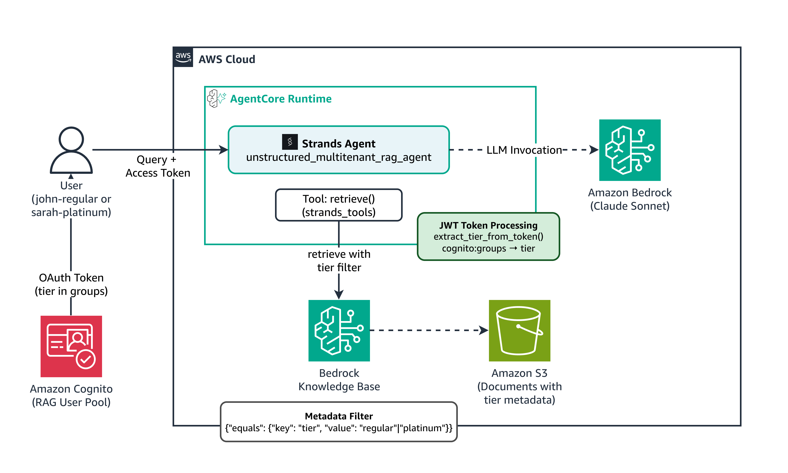

# 01 - Unstructured Multi-Tenant RAG with Metadata Filtering

Multi-tenant RAG system using OAuth 2.0 Access Tokens with Cognito groups for insurance tier isolation.

## What This Demonstrates

- Access Token authentication with Cognito groups (`regular`, `platinum`)
- Metadata-based tier isolation at vector DB layer
- Pooled Knowledge Base architecture (cost-efficient)
- Document-level access control by insurance tier
- Production-ready OAuth 2.0 pattern with `strands_tools.retrieve`

## When to Use

- Multi-tenant SaaS applications
- Unstructured document repositories (policies, claims, benefits)
- Tier-based access control (regular vs premium customers)
- Shared infrastructure with strict data isolation
- Production deployments requiring OAuth 2.0 compliance

## Architecture



```
╔═══════════════════════════════════════════════════════════════════════════╗
║                              INTERNET                                     ║
╠═══════════════════════════════════════════════════════════════════════════╣
║                                                                           ║
║  ┌─────────────────────────────────────────────────────────────────────┐  ║
║  │                     User Application                                │  ║
║  │    john-regular (regular tier) / sarah-platinum (platinum tier)     │  ║
║  └───────────────────────────┬─────────────────────────────────────────┘  ║
║                              │ Authorization: Bearer <ACCESS_TOKEN>       ║
║                              │ (cognito:groups contains tier)             ║
║                              ▼                                            ║
║  ┌─────────────────────────────────────────────────────────────────────┐  ║
║  │                  AgentCore Runtime                                  │  ║
║  │           (unstructured_multitenant_rag agent)                      │  ║
║  │  ┌───────────────────────────────────────────────────────────────┐  │  ║
║  │  │ 1. JWT Validation (allowedClients)                            │  │  ║
║  │  │ 2. Extract tier from cognito:groups claim                     │  │  ║
║  │  │ 3. Build metadata filter: {tier: "regular"}                   │  │  ║
║  │  │ 4. Call strands_tools.retrieve with filter                    │  │  ║
║  │  └───────────────────────────────────────────────────────────────┘  │  ║
║  └───────────────────────────┬─────────────────────────────────────────┘  ║
║                              │                                            ║
║                              ▼                                            ║
║  ┌─────────────────────────────────────────────────────────────────────┐  ║
║  │                  Bedrock Knowledge Base                             │  ║
║  │              (OpenSearch Serverless Vector DB)                      │  ║
║  │  ┌───────────────────────────────────────────────────────────────┐  │  ║
║  │  │ Documents with metadata:                                      │  │  ║
║  │  │   • policy.txt {tier: "regular"}    → $1000 deductible        │  │  ║
║  │  │   • policy.txt {tier: "platinum"}   → $500 deductible         │  │  ║
║  │  │   • claims.txt {tier: "regular"}    → 5-7 day processing      │  │  ║
║  │  │   • claims.txt {tier: "platinum"}   → 24-48 hour processing   │  │  ║
║  │  └───────────────────────────────────────────────────────────────┘  │  ║
║  └─────────────────────────────────────────────────────────────────────┘  ║
║                                                                           ║
╚═══════════════════════════════════════════════════════════════════════════╝
```

## Key Components

- **Cognito User Pool** with groups (`regular`, `platinum`)
- **OpenSearch Serverless** for vector storage
- **Bedrock Knowledge Base** with metadata filtering
- **Strands Agent** using `strands_tools.retrieve` with tier filter
- **AgentCore Runtime** with JWT validation (`allowedClients`)

## Files

- `01-unstructured-multitenant-rag.ipynb` - Main tutorial notebook
- `unstructured_multitenant_rag_agent.py` - Agent implementation with tier-based filtering
- `requirements.txt` - Python dependencies

## Test Users

| User | Email | Tier | Access |
|------|-------|------|--------|
| john-regular | john.regular@example.com | regular | $1000 deductible, 5-7 day processing |
| sarah-platinum | sarah.platinum@example.com | platinum | $500 deductible, 24-48 hour processing |

## Run

```bash
cd notebooks/01-unstructured-multitenant-rag
jupyter notebook 01-unstructured-multitenant-rag.ipynb
```

## What You'll Learn

1. How to create Cognito groups for multi-tenant applications
2. How to build a complete Knowledge Base infrastructure
3. How to implement metadata filtering for tier isolation
4. How to extract tier from `cognito:groups` claim in Access Token
5. How to use `strands_tools.retrieve` with filters
6. How to deploy production-ready multi-tenant RAG systems

## Next Steps

After completing this tutorial:
- **Tutorial 02**: Learn structured data access with Aurora Serverless RLS
- **Tutorial 03**: Build enterprise demo with production UI
