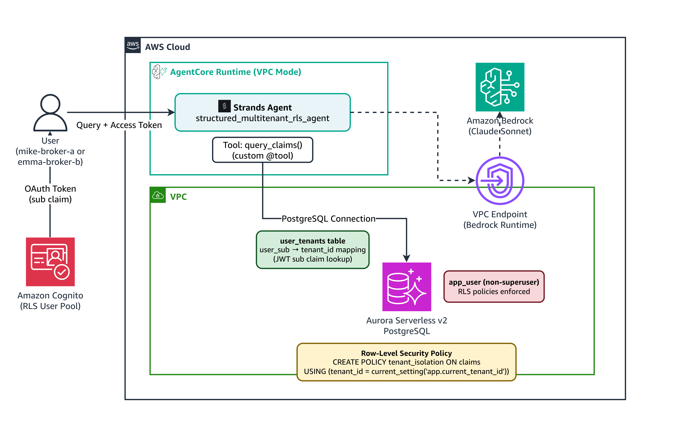

# 02 - Structured Multi-Tenant RLS with Row-Level Security

Multi-tenant database access using Aurora Serverless v2 PostgreSQL with Row-Level Security (RLS).

## What This Demonstrates

- Aurora Serverless v2 PostgreSQL with Row-Level Security
- Access Token authentication with JWT validation
- User-to-tenant mapping via database lookup
- Automatic tenant isolation at database layer
- Production-ready pattern for multi-tenant databases

## When to Use

- Multi-tenant structured data (claims, policies, customer records)
- Relational database with complex queries
- Row-level access control by tenant
- Compliance requirements for data isolation
- Production deployments with PostgreSQL

## Architecture



```
╔═══════════════════════════════════════════════════════════════════════════╗
║                              INTERNET                                     ║
╠═══════════════════════════════════════════════════════════════════════════╣
║                                                                           ║
║  ┌─────────────────────────────────────────────────────────────────────┐  ║
║  │                     User Application                                │  ║
║  │      mike-broker-a (Broker A) / emma-broker-b (Broker B)            │  ║
║  └───────────────────────────┬─────────────────────────────────────────┘  ║
║                              │ Authorization: Bearer <ACCESS_TOKEN>       ║
║                              ▼                                            ║
║  ┌─────────────────────────────────────────────────────────────────────┐  ║
║  │                  AgentCore Runtime                                  │  ║
║  │            (structured_multitenant_rls agent)                       │  ║
║  │  ┌───────────────────────────────────────────────────────────────┐  │  ║
║  │  │ 1. JWT Validation (allowedClients)                            │  │  ║
║  │  │ 2. Extract user_sub from JWT                                  │  │  ║
║  │  │ 3. Lookup tenant_id from user_tenants table                   │  │  ║
║  │  │ 4. SET app.current_tenant_id = 'broker-a'                     │  │  ║
║  │  │ 5. Execute SQL query (RLS filters automatically)              │  │  ║
║  │  └───────────────────────────────────────────────────────────────┘  │  ║
║  └───────────────────────────┬─────────────────────────────────────────┘  ║
║                              │                                            ║
╚══════════════════════════════╪════════════════════════════════════════════╝
                               │
╔══════════════════════════════╪════════════════════════════════════════════╗
║                    AWS VPC   │                                            ║
╠══════════════════════════════╪════════════════════════════════════════════╣
║                              ▼                                            ║
║  ┌─────────────────────────────────────────────────────────────────────┐  ║
║  │              Aurora Serverless v2 (PostgreSQL)                      │  ║
║  │                    Row-Level Security Enabled                       │  ║
║  │  ┌───────────────────────────────────────────────────────────────┐  │  ║
║  │  │ RLS Policy:                                                   │  │  ║
║  │  │   CREATE POLICY tenant_isolation ON claims                    │  │  ║
║  │  │   USING (tenant_id = current_setting('app.current_tenant_id'))│  │  ║
║  │  │                                                               │  │  ║
║  │  │ Claims Table:                                                 │  │  ║
║  │  │   • CLM-A-001 {tenant_id: "broker-a"} → John Doe $5000        │  │  ║
║  │  │   • CLM-A-002 {tenant_id: "broker-a"} → Jane Smith $3500      │  │  ║
║  │  │   • CLM-A-003 {tenant_id: "broker-a"} → Bob Johnson $7200     │  │  ║
║  │  │   • CLM-B-001 {tenant_id: "broker-b"} → David Lee $6500       │  │  ║
║  │  │   • CLM-B-002 {tenant_id: "broker-b"} → Emma Davis $4800      │  │  ║
║  │  └───────────────────────────────────────────────────────────────┘  │  ║
║  └─────────────────────────────────────────────────────────────────────┘  ║
║                                                                           ║
╚═══════════════════════════════════════════════════════════════════════════╝
```

## Key Components

- **Cognito User Pool** with Access Token authentication
- **Aurora Serverless v2** with Row-Level Security policies
- **Strands Agent** with database query tools
- **RLS Policies** that filter by `app.current_tenant_id` session variable
- **AgentCore Runtime** with JWT validation

## Files

- `02-structured-multitenant-rls.ipynb` - Main tutorial notebook
- `structured_multitenant_rls_agent.py` - Agent implementation with RLS context
- `requirements.txt` - Python dependencies

## Test Users

| User | Email | Tenant |
|------|-------|--------|
| mike-broker-a | mike.broker@example.com | broker-a |
| emma-broker-b | emma.broker@example.com | broker-b |

## Run

```bash
cd notebooks/02-structured-multitenant-rls
jupyter notebook 02-structured-multitenant-rls.ipynb
```

## What You'll Learn

1. How to set up Aurora Serverless v2 with Row-Level Security
2. How to create RLS policies for tenant-based isolation
3. How to extract user identity from Access Token
4. How to map users to tenants via database lookup
5. How to build secure multi-tenant database agents

## Database Schema

```sql
-- Tenants table
CREATE TABLE tenants (
    tenant_id VARCHAR(50) PRIMARY KEY,
    name VARCHAR(100) NOT NULL
);

-- User-tenant mapping
CREATE TABLE user_tenants (
    user_sub VARCHAR(100) PRIMARY KEY,
    tenant_id VARCHAR(50) REFERENCES tenants(tenant_id)
);

-- Claims table with RLS
CREATE TABLE claims (
    id SERIAL PRIMARY KEY,
    tenant_id VARCHAR(50) REFERENCES tenants(tenant_id),
    claim_number VARCHAR(20) NOT NULL,
    customer_name VARCHAR(100) NOT NULL,
    claim_amount DECIMAL(10,2) NOT NULL,
    claim_date DATE NOT NULL,
    status VARCHAR(20) NOT NULL
);

-- Enable RLS
ALTER TABLE claims ENABLE ROW LEVEL SECURITY;

-- RLS Policy
CREATE POLICY tenant_isolation ON claims
    USING (tenant_id = current_setting('app.current_tenant_id', true));
```

## Next Steps

After completing this tutorial:
- **Tutorial 01**: Learn unstructured data access with RAG and metadata filtering
- **Tutorial 03**: Build enterprise demo with production UI
