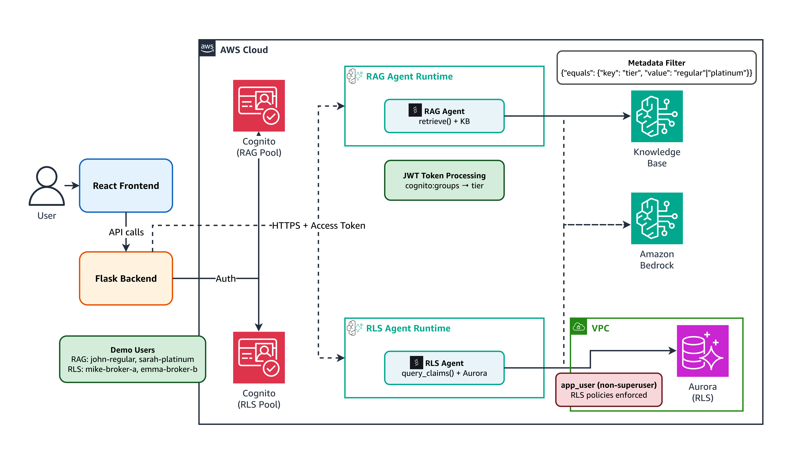

# 03 - Enterprise Orchestration Demo

Web-based demo application showcasing the multi-tenant agents from Tutorials 01 and 02.

## Overview

This tutorial provides a production-ready web interface to interact with the specialized agents built in previous tutorials. The frontend directly calls each agent with proper OAuth authentication, demonstrating real-world multi-tenant isolation.

## What This Demonstrates

- **Production UI**: AWS Cloudscape Design System
- **OAuth 2.0 Authentication**: Real Cognito tokens for each agent
- **Direct Agent Invocation**: Backend calls AgentCore agents via HTTPS with Bearer tokens
- **Multi-Tenant Isolation**: Each user sees only their tenant's data
- **Session Management**: Conversation history via session IDs

## Architecture



```
┌─────────────────────────────────────────────────────────────┐
│                    Frontend (React + Cloudscape)            │
│  - Login screen with agent selection                        │
│  - Policy Agent (RAG) or Claims Agent (RLS)                 │
│  - AI Chat Interface with markdown rendering                │
└────────────────────────┬────────────────────────────────────┘
                         │ API calls with Access Token
                         ↓
┌─────────────────────────────────────────────────────────────┐
│                    Backend API (Flask)                      │
│  - Demo login (authenticates with Cognito)                  │
│  - Query routing based on agent_type                        │
│  - HTTPS calls to AgentCore with Bearer token               │
└────────────────────────┬────────────────────────────────────┘
                         │
          ┌──────────────┴──────────────┐
          ↓                             ↓
┌────────────────────────┐  ┌──────────────────────────┐
│  Policy Agent          │  │ Claims Agent             │
│  (Tutorial 01)         │  │ (Tutorial 02)            │
│  - RAG with KB         │  │ - PostgreSQL with RLS    │
│  - Metadata filtering  │  │ - Row-level security     │
│  - Cognito Pool 1      │  │ - Cognito Pool 2         │
└────────────────────────┘  └──────────────────────────┘
```

## Key Components

### Frontend (React + Cloudscape)
- Login screen with two agent options (Policy Agent / Claims Agent)
- Demo users for each agent type
- Chat interface with markdown and table rendering
- Clickable suggestion queries

### Backend (Flask API)
- `/api/demo-login` - Authenticates with appropriate Cognito pool
- `/api/query` - Routes to correct agent based on agent_type header
- Direct HTTPS calls to AgentCore (boto3 SDK doesn't support OAuth)

## Files

```
03-enterprise-orchestration/
├── 03-enterprise-orchestration.ipynb   # Setup notebook (generates .env)
├── backend/
│   ├── app.py                          # Flask API server
│   ├── config.py                       # Configuration from .env
│   ├── .env                            # Generated by notebook
│   ├── .env.example                    # Template
│   └── requirements.txt
├── frontend/
│   ├── src/
│   │   ├── App.tsx                     # Main application
│   │   ├── components/
│   │   │   ├── LoginScreen.tsx         # Agent selection + demo login
│   │   │   └── ChatInterface.tsx       # Chat with markdown support
│   │   ├── services/api.ts             # API client
│   │   └── utils/formatters.ts
│   └── package.json
├── start.sh                            # Start both frontend and backend
└── README.md
```

## Prerequisites

Before starting this tutorial, you must have completed:
- **Tutorial 01**: Unstructured Multi-Tenant RAG (agent deployed)
- **Tutorial 02**: Structured Multi-Tenant RLS (agent deployed)

Both agents must be running - do NOT run cleanup cells.

## Quick Start

### Step 1: Run the Notebook

```bash
cd notebooks/03-enterprise-orchestration
jupyter notebook 03-enterprise-orchestration.ipynb
```

Run all cells to generate `backend/.env` with correct configuration.

### Step 2: Start the Application

```bash
./start.sh
```

Then open http://localhost:3000

## Demo Users

### Policy Agent (RAG - Tutorial 01)
| User | Tenant | Access |
|------|--------|--------|
| john-regular | Regular Tier | $1000 deductible, standard processing |
| sarah-platinum | Platinum Tier | $500 deductible, priority processing |

### Claims Agent (RLS - Tutorial 02)
| User | Tenant | Access |
|------|--------|--------|
| mike-broker-a | Broker A | CLM-A-001, CLM-A-002, CLM-A-003 |
| emma-broker-b | Broker B | CLM-B-001, CLM-B-002 |

## Environment Configuration

The notebook generates `backend/.env`:

```bash
AWS_REGION=us-west-2

# Tutorial 01 Cognito (RAG)
RAG_COGNITO_USER_POOL_ID=us-west-2_xxxxx
RAG_COGNITO_CLIENT_ID=xxxxx

# Tutorial 02 Cognito (RLS)
RLS_COGNITO_USER_POOL_ID=us-west-2_xxxxx
RLS_COGNITO_CLIENT_ID=xxxxx

# Agent ARNs
RAG_AGENT_ARN=arn:aws:bedrock-agentcore:us-west-2:xxx:runtime/unstructured_multitenant_rag-xxx
RLS_AGENT_ARN=arn:aws:bedrock-agentcore:us-west-2:xxx:runtime/structured_multitenant_rls-xxx
```

## How It Works

1. User selects an agent (Policy or Claims) and demo user
2. Backend authenticates with the appropriate Cognito pool
3. Frontend receives real Access Token
4. User sends a query
5. Backend calls AgentCore via HTTPS with Bearer token
6. Agent extracts tenant from JWT and filters data accordingly
7. Response displayed with markdown rendering

## Troubleshooting

### Port Already in Use
The `start.sh` script automatically kills existing processes on ports 5001 and 3000.

### Demo Login Failed
- Ensure Tutorial 01 and 02 notebooks were run completely
- Check that Cognito users were created
- Verify `.env` has correct pool IDs and client IDs

### Agent Call Failed
- Ensure agents from Tutorial 01 and 02 are still deployed
- Check agent ARNs in `.env` match deployed agents
- Verify AWS credentials are configured

## Cleanup

```bash
# Stop the application
Ctrl+C in the terminal running start.sh

# Or manually kill processes
pkill -f "python app.py"
pkill -f "react-scripts"
```

## Next Steps

- Customize the UI for your use case
- Add more demo users
- Integrate with your own Cognito setup
- Deploy to production with proper HTTPS
